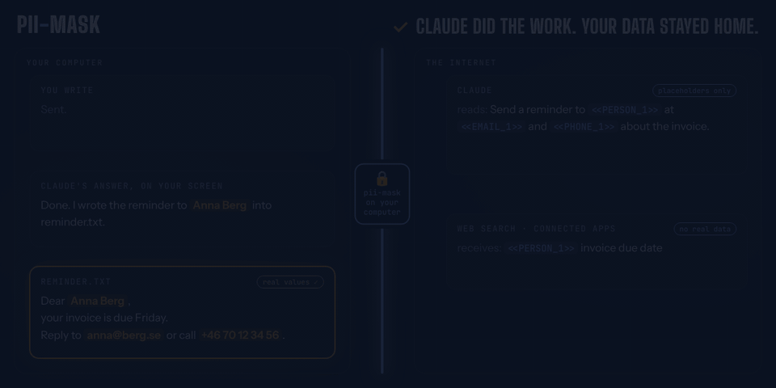

# pii-mask

**Use Claude Code without sending your personal data to the cloud.**



When you work with Claude Code, everything it reads goes to Claude: your messages, your files, the output of your commands. If those contain names, email addresses, phone numbers or account numbers, they go along too.

pii-mask stops that. Before anything leaves your computer, it swaps personal data for harmless placeholders. Claude works with the placeholders, and you still see the real values in every answer and in every file Claude writes for you.

## What it looks like

You write:

> Send a reminder to **Anna Berg** at **anna@berg.se** about the invoice.

Claude receives:

> Send a reminder to **‹PERSON 1›** at **‹EMAIL 1›** about the invoice.

Claude answers *"I've written the reminder to ‹PERSON 1›"*, and you read **"I've written the reminder to Anna Berg"**. The email Claude drafts into a file has Anna's real name and address in it. Claude never saw them.

## What it hides

Names · email addresses · phone numbers · home addresses · bank accounts and IBANs · card numbers · personal ID numbers (US, UK, Denmark, Sweden, Norway, Finland, and any number labelled as an ID) · passport numbers · dates of birth · IP and device addresses · GPS coordinates · passwords and API keys

You don't make a list or set anything up. Two things work together, both **on your own computer**:

- **A small AI model** recognises personal data in any text, in many languages, including what has no fixed form, like names and addresses.
- **A built-in checklist of about 30 patterns** catches everything with a fixed shape: email addresses, phone numbers, card numbers, IBANs, ID numbers, keys. Where a number has a check digit, the checklist verifies it, so ordinary numbers in your work aren't hidden by mistake. It also catches those when the model misses them.

## Get started

You need Claude Code, a Mac or Linux computer, and Python 3.9 or newer (most Macs and Linux machines already have it). On an older Mac with an Intel processor, it also needs Python 3.12 or older next to it (`brew install python@3.12`), because the AI library it uses has no newer version for those Macs.

**1. Install it.** In Claude Code, type:

```
/plugin install pii-mask --marketplace majidkabir/pii-mask
```

**2. Wait once.** The first time, pii-mask downloads its model (about 1.5–2.5 GB) and sets it up. That takes a few minutes. A panel above where you type shows how it's going:

```
⏳ pii-mask is installing its local model (first time only, about 1.5–2.5 GB)
█████████░░░░░░░░░░░░░░░  step 2 of 4: installing PyTorch (the largest download)
412 MB so far · 1 min 40 s on this step · Nothing is sent to Claude until it's ready.
```

If something goes wrong, the panel says what, and gives you the exact command that fixes it, with a **Retry** button. When it's done, a message says **pii-mask is on**, the panel goes away, and nothing is sent to Claude before that.

**3. Work as usual.** From then on, it starts by itself whenever you open Claude Code.

## See what was hidden

Type `/pii-mask` to open a side pane that lists everything hidden in this session, grouped by kind:

```
🔒 pii-mask on
3 values masked. Claude sees the placeholder; the real value stays on this machine.
People (1)
  Anna Berg           <<PERSON_1.k3f9>>
Emails (1)
  anna@berg.se        <<EMAIL_1.k3f9>>
Phone numbers (1)
  +46 70 12 34 56     <<PHONE_1.k3f9>>
```

The pane updates while you work. It's only shown on your screen and is never sent to Claude.

## Good to know

- **When in doubt, it holds back.** If the model isn't ready or can't check something in time, that content is left out rather than sent. Claude tells you, and you can try again.
- **Web searches stay private too.** When Claude searches the web or uses a connected service, it sends the placeholder, not the real value.
- **It's not perfect.** A name the model doesn't recognise goes through as written. And the rest of a sentence can still give someone away ("my sister, the only dentist in Skagen").
- **Pictures are left out.** Screenshots and PDFs can't be checked, so they aren't sent. Claude will ask you to describe them instead.
- **Everything stays on your computer.** The model runs locally and stops by itself when you're not using it. To remove it completely, delete the folder `~/.cache/pii-mask`.

## Status

This is an early experiment. It was built and tested with a stand-in for the real model, so the first runs on real machines will show how fast and how accurate it is. Windows isn't supported yet.

## More

- [How it works](docs/how-it-works.md): the technical details
- [Open questions](docs/open-questions.md): known gaps
- [Development](docs/development.md): building and testing it
- [customer-mask](https://github.com/majidkabir/customer-mask): the sibling project, for hiding a company's customers from a list

MIT licence. The model it downloads, [GLiNER PII](https://huggingface.co/urchade/gliner_multi_pii-v1), is Apache-2.0.
