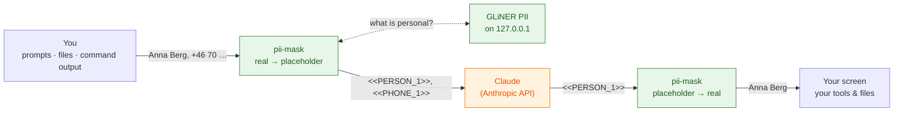

# pii-mask

A [Claude Code mod](https://claude.com/resources/articles/claude-code-mods) that keeps your personal data out of what Claude sees. No config.

Names, emails, phone numbers, addresses, IBANs, card, account, ID and passport numbers, dates of birth and IP addresses are replaced with placeholders such as `<<PERSON_1.k3f9>>` **before** anything is sent to the model. They are put back **after**: in the reply you read, and in the commands and file edits Claude makes. Tools that send data off your machine (web search, web fetch, every MCP tool) keep the placeholders.

There is no list to maintain. A local NER model, [GLiNER PII](https://huggingface.co/urchade/gliner_multi_pii-v1), reads the text on your machine and finds the personal data. The mod installs and runs it for you.

It is the personal sibling of [customer-mask](https://github.com/majidkabir/customer-mask), which masks a company's customers from a list. This one finds personal data without being told what to look for.



## What it looks like

| | Text |
| --- | --- |
| A row in `contacts.csv` | `Anna Berg,anna@berg.se,+46 70 12 34 56` |
| What Claude receives | `<<PERSON_1.k3f9>>,<<EMAIL_1.k3f9>>,<<PHONE_1.k3f9>>` |
| The command Claude asks for | `echo "<<PERSON_1.k3f9>> <<PHONE_1.k3f9>>" > note.txt` |
| What actually runs, and what's in `note.txt` | `Anna Berg +46 70 12 34 56` |

`k3f9` stands for a random marker each session picks. Only placeholders with this session's marker are ever restored.

## Install

You need Claude Code **2.1.302** or newer, **macOS or Linux**, and **Python 3.9** or newer on the `PATH`. At the Claude Code prompt:

```
/plugin install pii-mask --marketplace majidkabir/pii-mask
```

That's all. The first session installs the model by itself:

1. The status line shows `⏳ pii-mask: installing its model (2/4 installing PyTorch …)`. It creates its own Python environment in `~/.cache/pii-mask`, installs PyTorch (the CPU build on Linux) and GLiNER, and downloads the model from Hugging Face once. Expect roughly 1.5–2.5 GB and a few minutes, depending on your connection.
2. **Until it's done, nothing is sent.** A message you send meanwhile is answered locally with the progress, and is removed from the conversation so it can't go out unmasked later. Send it again once the status line shows `🔒 pii-mask on`.
3. Later sessions start the model in a few seconds. One model server is shared by all your sessions; it listens on `127.0.0.1:8766` only, logs nothing it is sent, and stops after 30 idle minutes. The next session starts it again.

`/pii-mask` shows the model's state, how fast it answers and everything replaced so far. `/pii-mask retry` starts the model again after a failure.

To remove everything it installed: `rm -rf ~/.cache/pii-mask`.

## What is covered

| Data path | Masked? |
| --- | --- |
| Your prompts | ✅ |
| File contents Claude reads, command output, search results (all tool results) | ✅ |
| `CLAUDE.md`, `@file` mentions, reminders, the per-session parts of the system prompt | ✅ |
| Subagents' conversations | ✅ |
| Arguments of `WebSearch`, `WebFetch` and every MCP tool | ✅ kept masked |
| A value the model found once, written again later (any case, any spacing) | ✅ masked even where the model misses it |
| The session's files on disk (`~/.claude/projects/…`) | ✅ when the session ends; the placeholder table saved beside them holds the real values |
| `claude -p` / SDK output | 🟡 masked; restore it with `… --output-format json \| node tools/unmask.mjs` |
| Images and PDFs | ✅ removed before sending, and Claude is told why |
| Personal data the model doesn't recognise | ❌ goes out as written; there are no fallback rules |
| What the rest of the text gives away (a job title, a town, a story) | ❌ masking hides values, not context |

**It fails closed.** If the model isn't running, is still installing, or doesn't answer within 7 seconds, the content is removed instead of sent, and requests are answered locally with the reason. A tool call whose arguments can't be restored is denied.

## What the model looks for

| The model's label | Placeholder |
| --- | --- |
| person | `PERSON` |
| email | `EMAIL` |
| phone number | `PHONE` |
| address | `ADDRESS` |
| iban | `IBAN` |
| bank account number | `ACCOUNT` |
| credit card number | `CARD` |
| social security number, national id number | `ID_NUMBER` |
| passport number | `PASSPORT` |
| date of birth | `BIRTHDATE` |
| ip address | `IP` |

A find counts at a confidence of 0.5 or more. Finds that can't be what their label says are dropped. That covers code the model mistakes for a name (`onMatch`, `RAW_FIELDS`), an "email" without `@`, a "phone number" with fewer than 6 digits, and Claude Code's own words (`Claude`, `Bash`, `JSON`, …). These checks only remove mistakes; they never find anything themselves.

## Status

Version 0.1, an experiment. **The real model has not been run with the mod yet:** the machine it was built on could not reach Hugging Face. The mod, the server and the setup were tested with a stand-in model (see [development](docs/development.md)); the first run with GLiNER will show its real speed and accuracy. Read [open questions](docs/open-questions.md) before you rely on it.

## Documentation

- **[How it works](docs/how-it-works.md)**: the hooks, the model's life cycle, placeholders, failing closed
- **[Open questions](docs/open-questions.md)**: known gaps and what is not verified
- **[Development](docs/development.md)**: layout, tests, the stand-in model

## License

[MIT](LICENSE). The GLiNER PII model it downloads is Apache-2.0.
