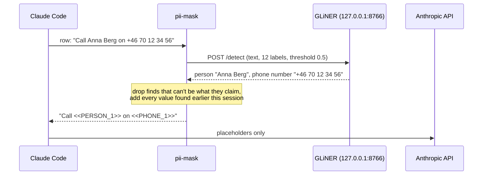
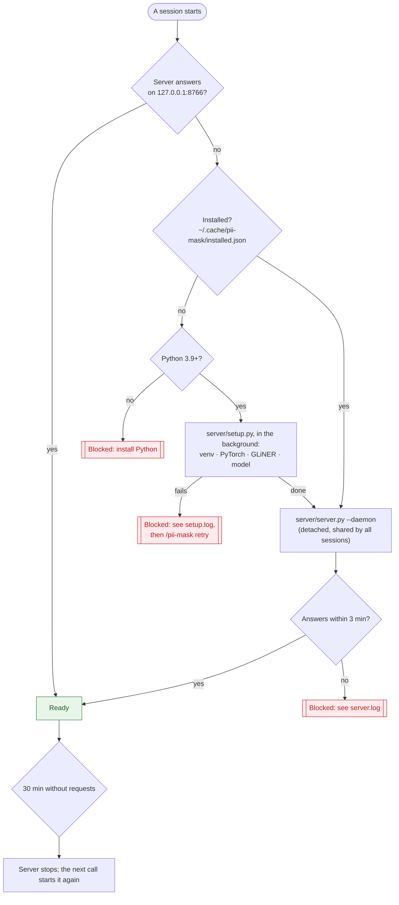

# How it works

pii-mask is built like [customer-mask](https://github.com/majidkabir/customer-mask), with one difference: a local NER model decides what to mask, not a list.

## 1. The hooks

All hooks are in [`hooks/register.ts`](../hooks/register.ts). The masking itself is a pure module, [`hooks/masker.ts`](../hooks/masker.ts), with no Claude Code dependency.

| Event | What it does |
| --- | --- |
| `session.append` | Every row the conversation keeps (prompts, tool results, replies) passes here before it is stored and before any request sends it. The row's text goes to the model, what it finds is masked, and images and PDFs are removed. If the model can't check the row, a `.catch` stores it with its text replaced by a note. |
| `prompt.compose` | Masks the per-session parts of the system prompt and adds a note telling Claude how to use placeholders. Runs for every request; the same text gives the same output, so the prompt cache keeps working. |
| `prompt.context` | Masks `CLAUDE.md` and the other blocks of the first message. If the model wasn't running yet, they are replaced by notes and rendered again once it is. |
| `prompt.attachment` | Masks text Claude Code injects (an `@file` mention, reminders); left out if that fails. |
| `classic.UserPromptSubmit` | Titles the session from the masked prompt, so the raw prompt isn't sent to make a title. |
| `turn.step` | Unmasks the reply as it streams, holding back a placeholder split across two pieces. While the model isn't running, answers locally with the reason instead of calling Claude. |
| `tool.call` | Restores real values in tool arguments before the permission prompt and the tool see them. `WebSearch`, `WebFetch` and every MCP tool keep their placeholders. Denies the call if restoring fails. |
| `classic.SessionStart` | Finds the transcript; on resume, adopts the placeholder table saved beside it. |
| `session.end` | Masks the copies Claude Code wrote to disk on its own, with every value found during the session. |
| `session.start`, `command.run` | Status line and `/pii-mask`. |

## 2. Finding the values

- **One request per row.** All of a row's text goes to the server in one call. Text it already answered for (the system prompt, sent with every request) comes from a cache.
- **Long text is split** into chunks of whole lines, up to 1,000 characters each, because GLiNER reads about 384 words at a time. The line numbers Claude Code's Read tool adds are skipped, and positions are mapped back to the original text.
- **A value found once stays masked.** Every value in the placeholder table is matched again in all later text, in any case and with any spacing, so a name the model recognised in one place is masked where it misses it in another.
- **Mistakes are dropped.** Each label has a shape check: a person's name has no code characters or camelCase, an email has an `@`, a phone number at least 6 digits, a card number at least 12. Claude Code's own words (`Claude`, `Bash`, `JSON`, …) and the placeholder labels are never masked.

## 3. The model's life cycle

- **Install** (`server/setup.py`): a virtual environment in `~/.cache/pii-mask/venv`, PyTorch (on Linux from the CPU-only index first, which is a fraction of the default build), `gliner`, and the model, downloaded to `~/.cache/pii-mask/hf`. It reports each step to the status line and logs to `setup.log`. A hook can't run for minutes, so this runs in the background while requests are answered locally with the progress.
- **Run** (`server/server.py`): detaches from the session that started it, so it keeps serving the other sessions. It binds `127.0.0.1` only, refuses a second start on the same port, loads the model with Hugging Face set to offline (nothing is fetched at run time), and never logs request text.
- **Wait**: a hook that needs the model while it is loading waits up to 6 seconds, then fails closed. A model call may take 7 seconds. A server that stopped while idle is started again on the next call.

## 4. Placeholders

`<<LABEL_n.mmmm>>`, for example `<<PERSON_1.k3f9>>`:

- **`LABEL_n`**: the same value gets the same number for the whole session, so Claude can reason across turns and earlier messages never change.
- **`-k`** after the number (`PERSON_1-2`): another spelling of the same value (`ANNA BERG`). Each spelling is restored exactly as written, which Claude's Edit tool needs to find the text in a file.
- **`.mmmm`**: a random marker chosen when the session starts. Only placeholders with this marker are restored, so text that just looks like a placeholder is left alone.
- **The table** lives in memory, in the session's state (it survives a hot reload of the mod) and in `<session-id>.pii-mask.json` beside the transcript, so a resumed session restores its placeholders. That file holds the real values in plain text.

## 5. Failing closed

A hook that throws or runs past its 10-second budget is skipped by Claude Code, and for a masking hook that would mean the text goes out as it was. So every masking hook has a `.catch` that answers in its place:

| What goes wrong | What happens |
| --- | --- |
| The model is installing, starting too slowly, or can't run | Requests are answered locally with the reason; rows are stored with their text removed |
| A model call fails or takes over 7 s | That row's text is removed; the system prompt's per-session parts are replaced by a note; injected text is left out |
| Real values can't be restored in a tool call | The call is denied, and Claude can retry it |
| Claude Code is older than 2.1.302, or the saved table can't be read | Every request is answered locally with the reason |
